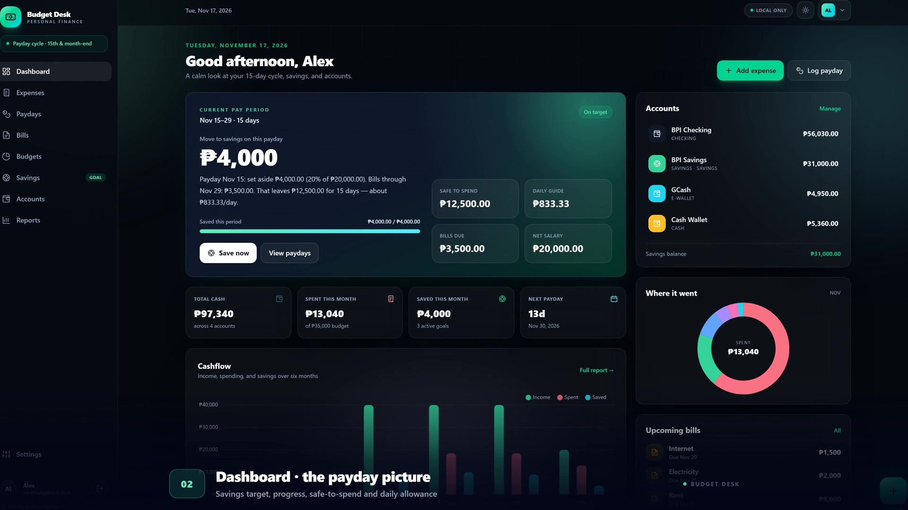

# Budget Desk

A private, single-user budget and savings app built with **Laravel 12 + Livewire 3 + Tailwind CSS 4**.
It is designed around a **semi-monthly payday cycle (15th and end of month)** and runs entirely on your
own machine — no cloud, no bank connections, no registration.

   

[](docs/budget-desk-tour.mp4)

**System tour:** [5-minute narrated video](docs/budget-desk-tour.mp4) · [subtitles](docs/budget-desk-tour.srt)

## What it does

- **Payday advice** — for each salary, calculates a savings target (default 20% of net, rounded to ₱100),
  bills due inside that pay period, safe-to-spend, and a daily guide.
- **Expenses** — quick-add from any page, filter by month/category/account, edit and delete.
- **Bills** — recurring monthly bills with due-day handling (day 31 clamps to the last day of short months),
  paid/upcoming state, and "Log payment" that creates a linked expense.
- **Budgets** — per-category monthly limits, copy previous month, apply category defaults, live progress.
- **Savings** — goals (with one emergency fund), tagged transfers, per-payday target vs. actual record,
  and confetti when a goal is reached.
- **Accounts** — cash, checking, savings, e-wallet, investment; computed balances and a running ledger.
  Balances are never stored.
- **Reports** — cashflow and savings charts for six months, category breakdown, budget performance, CSV export.
- **Settings** — savings rate, rounding step, currency, emergency-fund months, JSON backup/export.
- **Polish** — light/dark theme (dark default, remembered), animated background, staggered entrances,
  count-up numbers, animated progress bars, toasts, and `prefers-reduced-motion` support.

## Money rules (implementation contract)

1. A **pay period** starts on a payday and ends the day before the next scheduled payday.
   Aug 15 → Aug 15–30; Aug 31 → Aug 31–Sep 14.
2. **Calendar months** are only used for budgets and monthly reports.
3. `target = round(net × rate / 100 / step) × step` (default ₱100, step 0 disables rounding).
4. `bills_due` = active bills whose due date falls inside the period; a bill due on payday belongs to the new period.
5. `safe_to_spend = max(0, net − bills_due − target)`; shortfall warning when `net − bills_due < target`.
6. Savings = transfers **from non-savings accounts into** accounts flagged `counts_as_savings`.
   Savings→savings transfers never count; goal-tagged withdrawals reduce progress.
7. All balances, budget actuals, savings totals, and goal progress are **computed on read**.

The full specification lives in [`docs/SPEC.md`](docs/SPEC.md).

## Requirements

- PHP **8.2+** with `pdo_mysql`, `mbstring`, `openssl`, `fileinfo`
- MySQL / MariaDB (developed against MariaDB 10.4)
- Composer 2, Node 20+ and npm

## Setup

```bash
# 1. Install dependencies
composer install
npm install

# 2. Configure
cp .env.example .env
php artisan key:generate

# 3. Create a MySQL database named budget_desk, then set DB_* in .env
#    DB_CONNECTION=mysql
#    DB_DATABASE=budget_desk
#    DB_USERNAME=root
#    DB_PASSWORD=

# 4. Build the schema and load starter data
php artisan migrate
php artisan db:seed

# 5. Build assets (or use npm run dev while developing)
npm run build

# 6. Run it
php artisan serve
```

Open <http://127.0.0.1:8000>.

### Login

Single-user login, no registration route:

```
email:    me@budgetdesk.local
password: password
```

Change the defaults with `SEED_EMAIL`, `SEED_PASSWORD`, and `SEED_NAME` in `.env`, then re-run
`php artisan db:seed`. Stored budgets are calculated in `Asia/Manila` (configurable via `APP_TIMEZONE`).

## Starter data

`DatabaseSeeder` creates the user, settings, four accounts, eight categories, three bills, three goals,
budgets for the current and previous two months, paydays for the last four months, matching savings
transfers, and a few months of expenses — all relative to **today**, so the dashboard is alive immediately.

To reproduce the exact acceptance scenario from the spec (August 2026) instead, use a fresh database:

```bash
php artisan migrate:fresh
php artisan db:seed --class=DemoSeeder
```

This scenario is asserted by `tests/Feature/AcceptanceScenarioTest.php`.

## Backups

```bash
php artisan budget:backup            # keeps the last 30 JSON snapshots
php artisan budget:backup --keep=90
```

Files are written to `storage/app/backups/`. The Settings page can trigger a backup and download a full
JSON export; Reports can export the selected month as CSV.

## Tests

```bash
php artisan test
```

Pest is not used: this environment runs PHP 8.2, and the Pest versions compatible with the installed PHPUnit
require PHP 8.3+. The suite uses **PHPUnit** and covers pay-period boundaries (including February and leap
years), bill due-day clamping, savings rounding, shortfall, savings-transfer rules, goal withdrawals,
balances, the full acceptance scenario, authentication, exports, and every page rendering.

Current status: **26 passing tests, 114 assertions**.

## Project layout

```
app/
  Console/Commands/BudgetBackup.php   JSON snapshot command
  Http/Controllers/Auth/              single-user login
  Http/Controllers/ReportExportController.php
  Livewire/                           full-page components per section
  Models/                             Settings, Account, Category, Payday, Expense, Bill, Budget,
                                      Transfer, SavingsGoal
  Services/                           PayPeriodService, SavingsAdvisor, BalanceService, ReportService
  Support/                            Money formatting, PayPeriod value object
database/
  migrations/2026_01_01_000001_create_budget_tables.php
  seeders/DatabaseSeeder.php          starter data relative to today
  seeders/DemoSeeder.php              exact spec scenario
docs/SPEC.md                          binding rules, schema, acceptance numbers
resources/views/livewire/             UI for each section
resources/css/app.css                 design system + animations
resources/js/app.js                   theme, toasts, count-up, Chart.js, confetti
```

## Notes

- This app is intended for local, personal use. Do not expose it to the internet without adding HTTPS,
  hardening, and real authentication/2FA.
- Chart.js and canvas-confetti are the only front-end libraries added beyond Laravel's defaults.
- The quick-add expense button is available from every page; use it as your daily logging habit.
